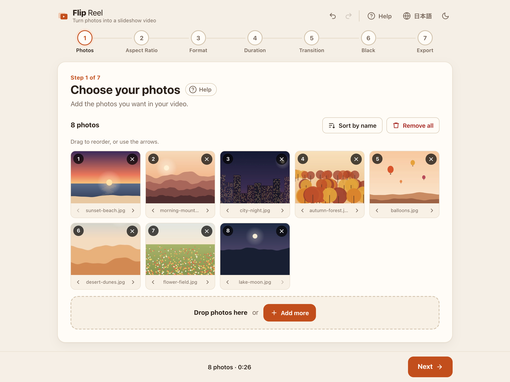
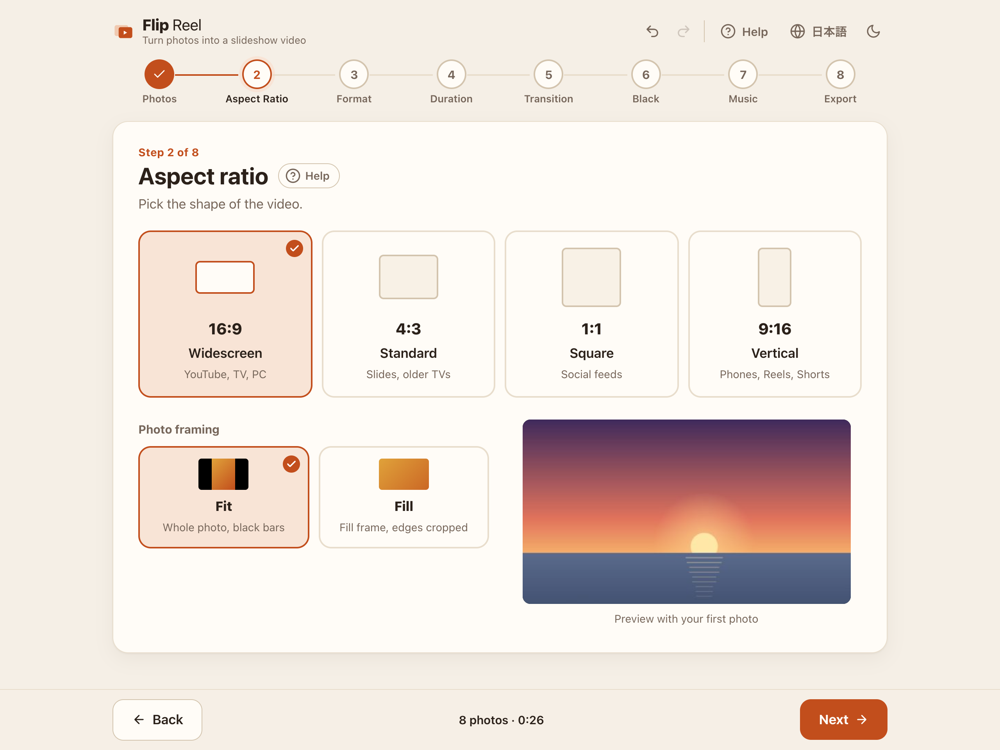
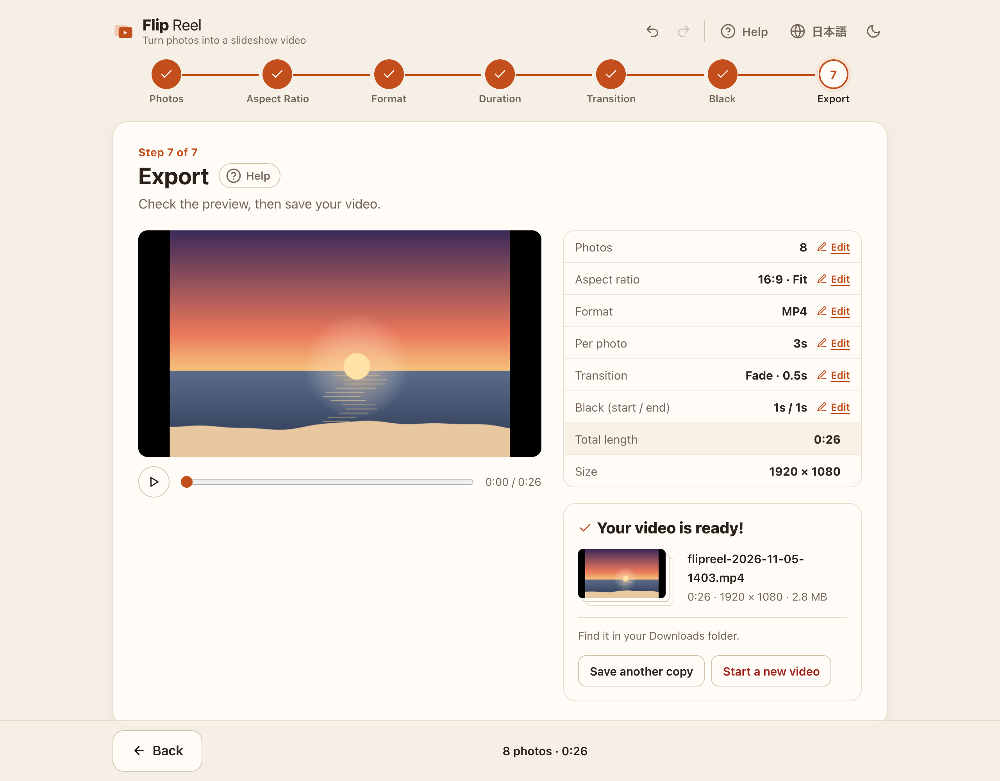
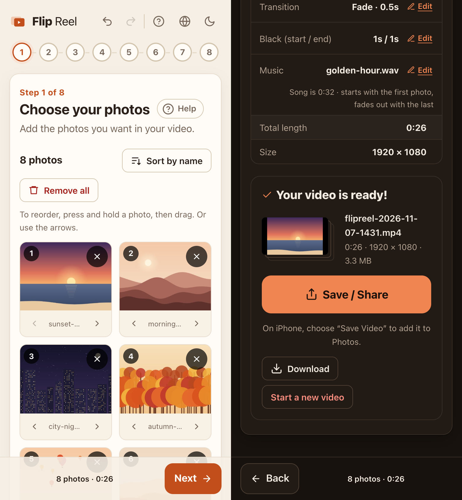

# Flip Reel

[English](README.md) | **日本語**

写真から、スライド動画をブラウザだけで作れるアプリです。

写真を追加して 7 つの短い質問に答えるだけで、MP4 か WebM の動画を保存できます。処理はすべてお使いの端末の中で行われ、写真がどこかに送られることはありません。

**▶ 使ってみる：[hugesesame.github.io/flipreel](https://hugesesame.github.io/flipreel/)**



| アスペクト比と写真の収め方 | プレビューと書き出し |
| --- | --- |
|  |  |



## できること

- **7 つのかんたんなステップ**：写真 → アスペクト比 → ファイル形式 → 表示時間 → トランジション → 黒み → 書き出し
- どのステップにも**最初からちょうどよい設定**が入っているので、「次へ」を押していくだけでも完成します
- **アスペクト比**：16:9・4:3・1:1・9:16。写真の収め方は「フィット」（全体を表示・余白は黒）か「フィル」（画面いっぱい・端を切る）
- **ファイル形式**：MP4（H.264）か WebM（VP9）。フル HD（短い辺 1080 px）、30 fps
- **トランジション**：カットかフェード。フェードの長さも変えられます
- 最初と最後の**黒み**
- **音楽（なくても OK）**：手持ちの曲（MP3・M4A・WAV など）を 1 曲入れられます。最初の黒みは無音、1 枚目の写真と一緒に始まり、最後の写真が暗くなるのに合わせてフェードアウトします
- 書き出す前の**プレビュー**
- 写真や設定の変更を**取り消し / やり直し**（⌘Z / Ctrl+Z、⇧⌘Z / Ctrl+Y）
- **保存先を選べる**（パソコンの Chrome / Edge）
- **スマホ・タブレット対応**：長押しで写真を並べ替え、共有シートから「写真」アプリに保存・共有、作成中は画面が消えない
- 各ステップをやさしい言葉で説明する**ヘルプ**
- **英語 / 日本語**の切り替え、**ライト / ダーク**の切り替え
- **プライバシー・オフライン**：アプリ全体が 1 つの HTML ファイルで、すべてブラウザの中で動きます

## 使い方

**Web で使う** — ブラウザで [hugesesame.github.io/flipreel](https://hugesesame.github.io/flipreel/) を開きます。スマホ・タブレットではこちらをお使いください。

**オフラインで使う** — [flipreel.html](https://hugesesame.github.io/flipreel/flipreel.html) をダウンロード（右クリック ›「リンク先を別名で保存」）し、ダブルクリックして Google Chrome か Microsoft Edge で開きます。インターネットへの接続は必要ありません。

あとは画面の案内に沿って進めます。わからないときは **ヘルプ** を押してください。

### 対応ブラウザ

| ブラウザ | 動画づくり | 保存のしかた |
| --- | --- | --- |
| Chrome / Edge（最新版） | ✅ | 保存するフォルダとファイル名を選べる |
| Safari 17 以降（Mac） | ✅ | 「ダウンロード」フォルダ |
| Firefox 130 以降 | ✅ | 「ダウンロード」フォルダ |
| iPhone / iPad の Safari（iOS 17 以降） | ✅ | 共有シート →「ビデオを保存」で「写真」アプリへ |
| Android の Chrome | ✅ | 共有シート、または「ダウンロード」フォルダ |

動作確認は、パソコンの Chrome と、Chrome のスマホ表示（エミュレーション）で行っています。Safari・Firefox・実機のスマホは WebCodecs に対応しているので動く見込みですが、まだ確認していません。

Safari や Firefox で毎回保存先を聞いてもらう設定方法は、アプリのヘルプで案内しています。

iPhone の HEIC 形式の写真は Safari でだけ開けます。ほかのブラウザでは、先に JPEG に変換してください。

## ビルド

[Node.js](https://nodejs.org/) 22 以降が必要です。

```sh
npm install
npm run build      # → dist/flipreel.html（1 ファイルで完結）
```

開発するとき：

```sh
npm run dev        # http://localhost:5173/flipreel.html を開く
npm run typecheck
```

`main` ブランチに push するたびに、自動でビルドして GitHub Pages に公開します（[.github/workflows/pages.yml](.github/workflows/pages.yml)）。

## しくみ

- 写真を `createImageBitmap` で読み込み、1 コマずつ canvas に描きます。
- 曲を入れた場合は Web Audio API で読み込み、映像と一緒に AAC（MP4）か Opus（WebM）で書き出します。
- 描いたコマをブラウザの [WebCodecs](https://developer.mozilla.org/ja/docs/Web/API/WebCodecs_API) で動画に変換し、[Mediabunny](https://mediabunny.dev/) で MP4 / WebM ファイルにまとめます。
- パソコンの Chrome / Edge では、[File System Access API](https://developer.mozilla.org/ja/docs/Web/API/Window/showSaveFilePicker) で選んだファイルへ直接書き込みます。スマホでは完成した動画を[共有シート](https://developer.mozilla.org/ja/docs/Web/API/Navigator/share)に渡し、そのほかのブラウザではダウンロードします。
- [Vite](https://vite.dev/) と [vite-plugin-singlefile](https://github.com/richardtallent/vite-plugin-singlefile) で JavaScript と CSS をすべて 1 つの HTML に埋め込んでいるため、ネットワークへの接続は不要です。

### ファイル構成

```
flipreel.html      入口の HTML
src/main.ts        画面・ステップ・プレビュー・操作
src/timeline.ts    タイムラインの計算とコマの描画（プレビューと書き出しで共通）
src/exporter.ts    動画への変換と保存
src/photos.ts      写真とサムネイルの読み込み
src/reorder.ts     写真の並べ替え（マウス・タッチ・ペン）
src/history.ts     取り消し / やり直しの履歴
src/i18n.ts        画面の文言（英語 / 日本語）
src/help.ts        ヘルプの本文（英語 / 日本語）
src/style.css      スタイル（ライト / ダーク）
```

スクリーンショットのサンプル写真は、この README のために描いたイラストです。
