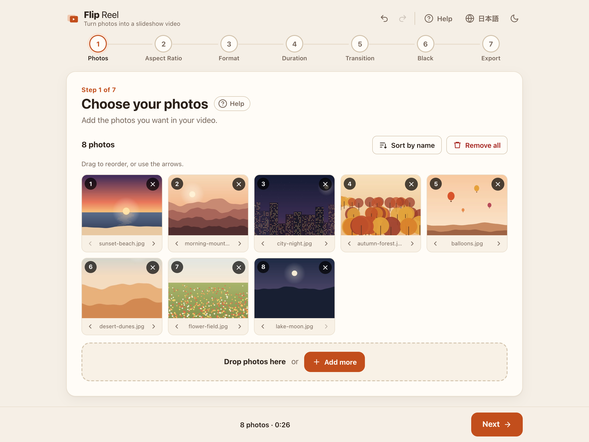
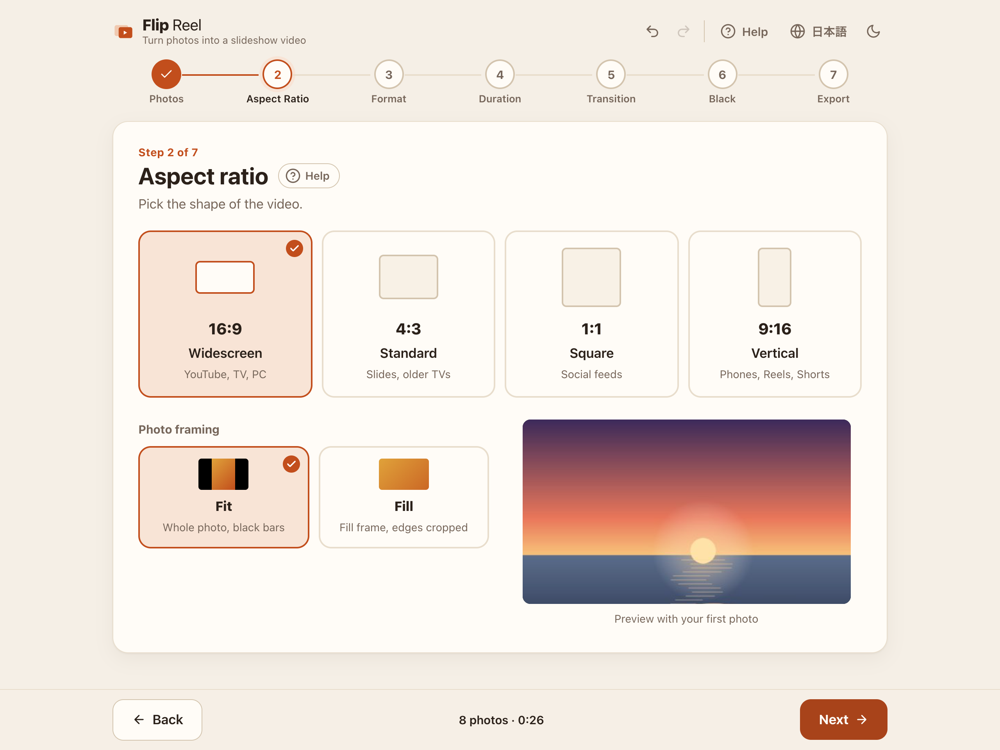
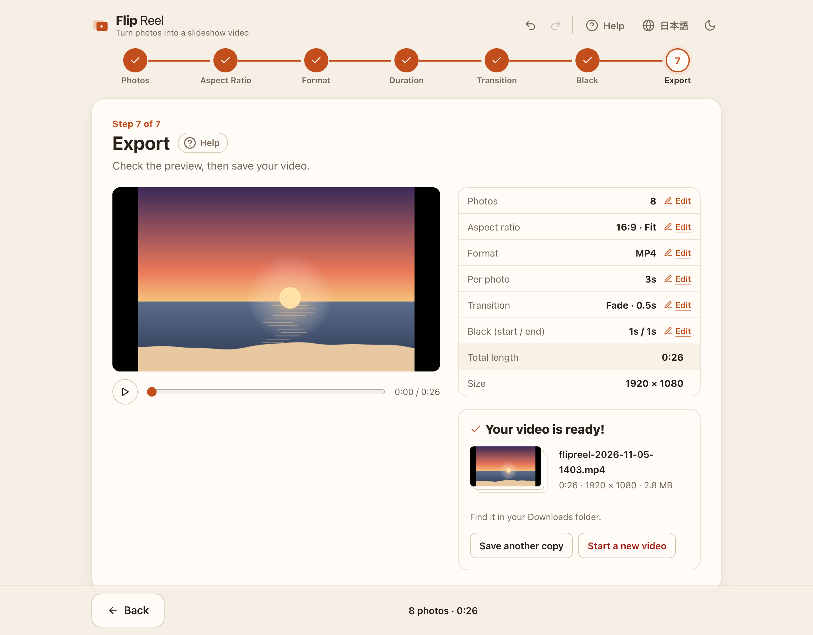
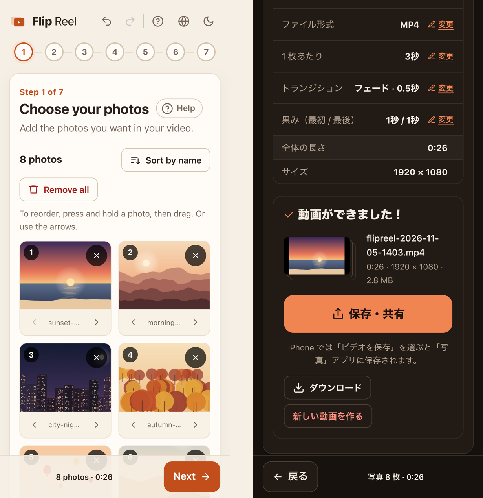

# Flip Reel

**English** | [日本語](README.ja.md)

Turn your photos into a slideshow video — right in your browser.

Add photos, answer seven short questions, and save an MP4 or WebM video. Everything happens on your device: your photos are never uploaded.

**▶ Try it: [hugesesame.github.io/flipreel](https://hugesesame.github.io/flipreel/)**



| Aspect ratio and framing | Preview and export |
| --- | --- |
|  |  |



## Features

- **Seven simple steps**: Photos → Aspect Ratio → Format → Duration → Transition → Black → Export
- **Sensible defaults** on every step, so you can just keep pressing *Next*
- **Aspect ratios**: 16:9, 4:3, 1:1, 9:16 — with *Fit* (whole photo, black bars) or *Fill* (crop to fill)
- **Formats**: MP4 (H.264) or WebM (VP9), full HD (short side 1080 px), 30 fps
- **Transitions**: Cut or Fade, with adjustable fade length
- **Black** lead-in and lead-out
- **Preview** before export
- **Undo / redo** (⌘Z / Ctrl+Z, ⇧⌘Z / Ctrl+Y) for photo and setting changes
- **Choose where to save** (Chrome / Edge on a computer)
- **Phones and tablets**: press and hold to reorder photos, save to Photos or share via the share sheet, screen stays on while the video is made
- **Built-in Help** that explains every step in plain language
- **English / Japanese** UI, **light / dark** theme
- **Private and offline**: the whole app is one HTML file that runs entirely in your browser

## Using Flip Reel

**Online** — open [hugesesame.github.io/flipreel](https://hugesesame.github.io/flipreel/) in your browser. This is the way to use it on a phone or tablet.

**Offline** — download [flipreel.html](https://hugesesame.github.io/flipreel/flipreel.html) (right-click › *Save Link As…*), then double-click it to open it in Google Chrome or Microsoft Edge. No internet connection needed.

Follow the steps. If you get stuck, press **Help**.

### Browser support

| Browser | Make videos | Saving |
| --- | --- | --- |
| Chrome / Edge (latest) | ✅ | Choose a folder and file name |
| Safari 17+ (Mac) | ✅ | Downloads folder |
| Firefox 130+ | ✅ | Downloads folder |
| Safari on iPhone / iPad (iOS 17+) | ✅ | Share sheet → *Save Video* to Photos |
| Chrome on Android | ✅ | Share sheet, or Downloads |

Flip Reel has been tested in Chrome on a computer and in Chrome's phone emulation. Safari, Firefox and real phones should work based on their WebCodecs support, but haven't been tested yet.

The Help screen explains how to make Safari and Firefox ask where to save every download.

HEIC photos (iPhone) open in Safari only; in other browsers, convert them to JPEG first.

## Building

Requires [Node.js](https://nodejs.org/) 22 or later.

```sh
npm install
npm run build      # → dist/flipreel.html (single self-contained file)
```

During development:

```sh
npm run dev        # then open http://localhost:5173/flipreel.html
npm run typecheck
```

Every push to `main` builds the app and publishes it to GitHub Pages ([.github/workflows/pages.yml](.github/workflows/pages.yml)).

## How it works

- Photos are decoded with `createImageBitmap` and drawn onto a canvas, one frame at a time.
- Frames are encoded with the browser's [WebCodecs](https://developer.mozilla.org/docs/Web/API/WebCodecs_API) API and packaged into MP4/WebM with [Mediabunny](https://mediabunny.dev/).
- In Chrome/Edge on a computer, the video is streamed straight to the file you picked with the [File System Access API](https://developer.mozilla.org/docs/Web/API/Window/showSaveFilePicker). Phones hand the finished video to the [share sheet](https://developer.mozilla.org/docs/Web/API/Navigator/share); other browsers download it.
- [Vite](https://vite.dev/) and [vite-plugin-singlefile](https://github.com/richardtallent/vite-plugin-singlefile) inline all JavaScript and CSS into one HTML file, so no network access is needed.

### Project layout

```
flipreel.html      Entry HTML
src/main.ts        UI, steps, preview player, actions
src/timeline.ts    Timeline model and frame drawing (shared by preview and export)
src/exporter.ts    Encoding and saving
src/photos.ts      Loading photos and thumbnails
src/reorder.ts     Drag to reorder (mouse, touch, pen)
src/history.ts     Undo / redo history
src/i18n.ts        UI strings (English / Japanese)
src/help.ts        Help content (English / Japanese)
src/style.css      Styles, light and dark themes
```

The sample photos in the screenshots are illustrations drawn for this README.

## Roadmap

- Background music (one track, faded out at the end)
